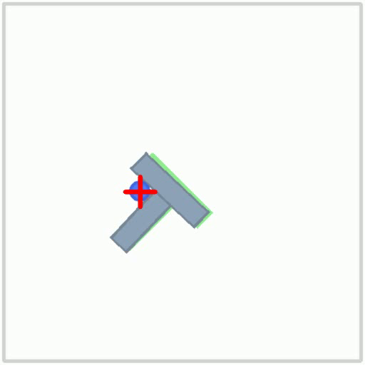
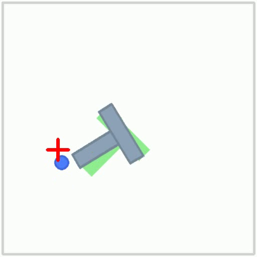
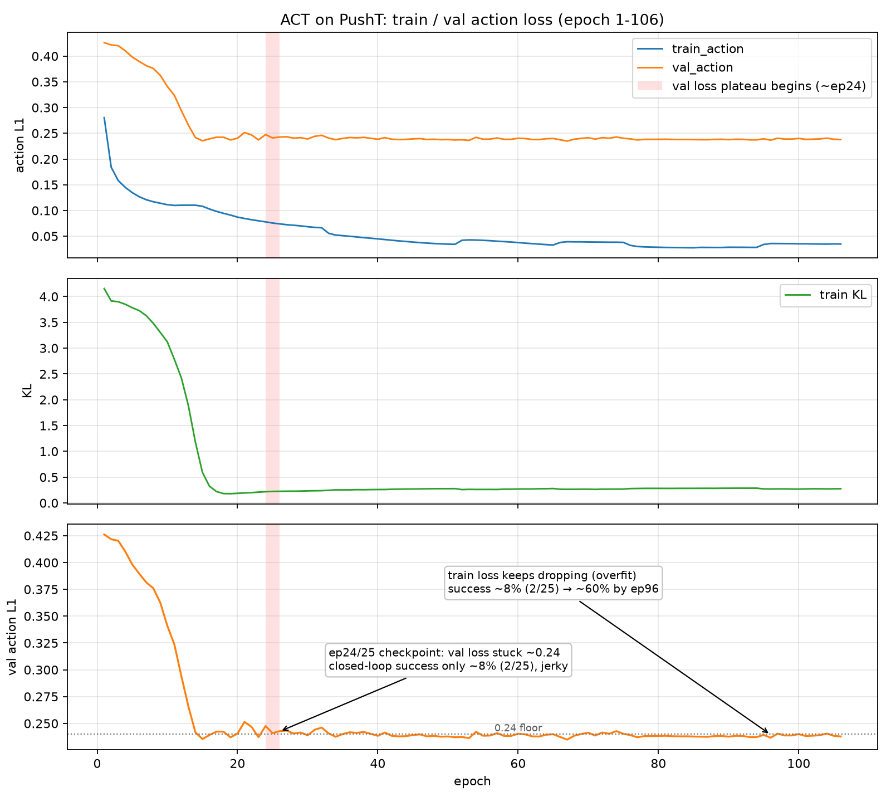
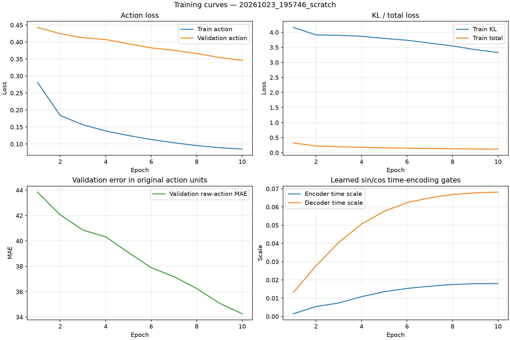
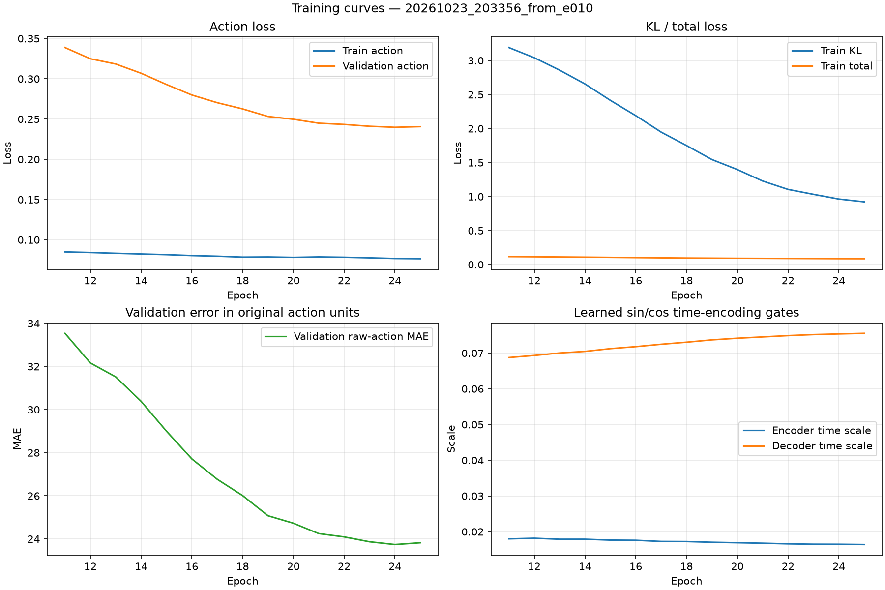
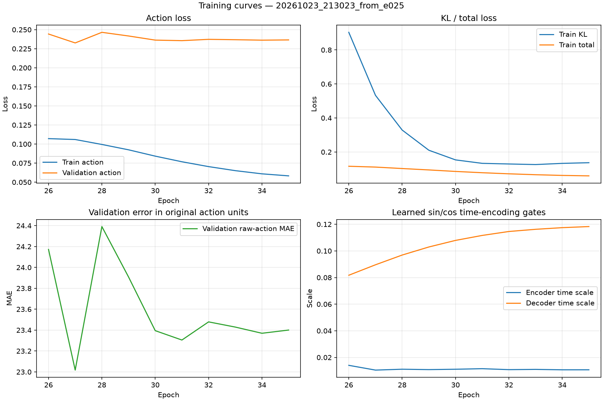

# ACT on PushT：从零实现 ACT + 门控正余弦时间编码

不依赖 LeRobot 的 policy 库，用 PyTorch 从零写出 ACT（ResNet18 视觉编码 + CVAE + Transformer decoder），在 PushT 上完成训练与闭环评测；随后定位到「动作块内的时间顺序只靠一组可学习位置向量表示」这个缺陷，设计了 **tanh 门控正余弦时间编码**，在旧权重上续训，闭环成功率 **50% → 60%**。

仓库保留了完整的训练日志、逐局评测 JSON 和所有复现脚本，也包括下面这段「离线 loss 早就卡死、闭环能力却还在涨」的实验记录。

<p>


</p>

**TL;DR**

- **复现**：模型、损失、数据缓存、训练循环、闭环评测全部手写，不依赖 LeRobot 的 policy 库。
- **改进**：动作块内的时间编码从「可学习位置向量」换成「tanh 门控的正余弦编码」，只多 2 个标量参数，旧 checkpoint 直接续训，闭环成功率 **50% → 60%**。
- **记录**：完整 106 epoch 训练曲线、逐局评测 JSON、9 个失败 episode 的归因，成功和失败都留在仓库里。

---

## 目录

- [效果演示](#效果演示)
- [结果](#结果)
- [训练曲线上的三个现象](#训练曲线上的三个现象)
- [我实现的 ACT](#我实现的-act)
- [核心改进：门控正余弦时间编码](#核心改进门控正余弦时间编码)
- [失败分析](#失败分析)
- [快速开始](#快速开始)
- [项目结构](#项目结构)
- [局限与下一步](#局限与下一步)
- [参考](#参考)

---

## 效果演示

续训后的 `best.pt`（epoch 96）在 `10 episodes / exec 8 / seed 1000` 下录制，下面是两局 rollout 的末帧——T 都已经压在目标区域上：

| rollout 末帧 · seed 1001 | rollout 末帧 · seed 1002 |
| :---: | :---: |
| [](docs/media/episode_001_seed_1001.mp4) | [](docs/media/episode_002_seed_1002.mp4) |
| [▶ 播放视频](docs/media/episode_001_seed_1001.mp4) | [▶ 播放视频](docs/media/episode_002_seed_1002.mp4) |

> GitHub 的 README 不渲染 `<video>` 标签，所以这里用封面图 + 视频链接；点开链接可以在浏览器里直接播放。

## 结果

四个 checkpoint，同一套评测脚本（`evaluate_stable.py`）、同一种执行方式（一次预测 16 步、闭环执行前 8 步后重新观测）：

| 模型 | checkpoint | 评测协议 | 成功率 | 平均最高覆盖率 |
| --- | --- | --- | --- | --- |
| 基础 ACT（可学习位置编码） | epoch 90 | 10 局 · exec 8 · seed 1000 | 50%（5/10） | 0.83 |
| + 门控正余弦（续训刚开始） | epoch 24–25 | 25 局 · exec 8 · seed 1000 | 8%（2/25） | — |
| + 门控正余弦（续训中段） | epoch 35 | 20 局 · exec 8 · seed 1000 | 20%（4/20） | 0.70 |
| + 门控正余弦（`best.pt`） | epoch 96 | 10 局 · exec 8 · seed 1000 | **60%（6/10）** | **0.86** |

- ep35 那条来自仓库里的 [eval_result.json](eval_result.json)，逐局 success / coverage / steps 都在里面；其余三行是训练时逐次评测的记录。
- 换一组起点与种子（e051 checkpoint、seed 4000、20 局）复测：续训 + 5 epoch 微调 55%（11/20），基线 50%（10/20），方向和上面一致。
- **样本量小**：60% 与 50% 只差 1 局。这组数字用来证明「改进方向对」，不是最终结论；正式结论还需要在独立保留种子（如 seed 5000）上跑 50 局，见[局限](#局限与下一步)。

## 训练曲线上的三个现象

基础 ACT 从零训练 32 epoch，之后 5 次续训把总轮数推到 106，全部 `loss_log.csv` 拼接起来就是下面这张图（原始日志在 [docs/media/loss_logs](docs/media/loss_logs)，跑 `python docs/media/make_full_curve.py` 可一键重画）：



**现象一：epoch 24 之后 val loss 卡死在 0.24。**

`val_action` 从 0.43 一路掉到 0.24 只用了 15 个 epoch，此后 80 多个 epoch 里一直在 **0.235–0.248** 之间横着走，最好的一轮也只到 0.235（ep67）。同一时间 `train_action` 还在从 0.078 缓慢掉到 0.035——训练集越拟合越好，验证集一动不动，这是典型的过拟合信号。按离线 loss 判断，ep24 就该停训了。

**现象二：KL 在同一时间被压到 0.2 附近，free bits 已经把梯度关掉了。**

`train_kl` 从 4.15 一路降到 0.22（ep24），之后在 0.2–0.28 之间平台。32 维、总 KL 0.22 nat ≈ 每维 0.007 nat，**已经低于 free bits 的下限 0.01**——也就是说 KL 项这时基本不产生梯度了，后验被推到先验 N(0,1) 附近，z 携带的信息很少，decoder 转而主要依赖图像 token 做预测。这未必是坏事：它只是放弃了「用 latent 解释每一步细节」这条路，而这件事恰好是开环 L1 最在意、闭环最不需要的。

**现象三：离线指标一动不动，闭环成功率却在后面 70 个 epoch 里从 8% 爬到 60%。**

这是这个项目里最反直觉的一段：ep24/25 的 checkpoint 只有 **8%（2/25）**，比基线的 50% 还差一大截；ep35 回到 20%（4/20）；ep96 才到 60%。也就是说，**训练曲线在 ep24 就变成一条直线，而闭环能力在这条直线底下继续长**。

原因是两者衡量的东西不一样。验证 loss 是**开环**指标：一次预测 16 步、和示范动作逐点比 L1，任何一步偏了就扣分。闭环 rollout 每执行 8 步就重新观测、重新规划，前面的偏差会被后面的动作块纠回来——模型只要**大方向对**就能赢，不需要每一步都精确。KL 收缩后策略不再纠缠每步细节，把能力集中到更稳的「平均方向」，恰好是闭环场景需要的。

所以选模型必须靠闭环评测，不能看 loss。这也是我把评测脚本和逐局 JSON 都留在仓库里的原因。

## 我实现的 ACT

`act_policy.py` 是标准 ACT 的精简复现，全部手写（不调用 LeRobot 的 policy 库）：

- **视觉编码**：ResNet18（ImageNet 预训练）去掉全局池化与分类头，输出 `512×3×3` 空间特征，展平成 9 个图像 token 投影到 `d_model=256`，加可学习空间位置编码。
- **CVAE 编码器**：训练时用 `[CLS] + 状态 + 真实动作序列` 推测隐变量 z 的 `(mu, logvar)`（2 层 Transformer encoder，`latent_dim=32`），重参数化采样；推理时 `z=0`，只走 decoder 先验路径。
- **观测编码器**：`[z, state, 9 个图像 token]` 过 2 层 Transformer encoder，作为 decoder 的 memory。
- **Decoder**：2 层 Transformer decoder，query = 可学习的 `16×256` 动作查询向量 + z 的线性投影偏置，cross-attend memory 后用线性头输出 `16×2` 的动作块。
- **损失（`loss.py`）**：动作 L1（只对有效时间步平均，padding 不计入）+ `beta × KL`，`beta=0.01` 固定小权重。关键是实现了 **free bits**：每维 KL 低于 0.01 nat 时梯度为零，防止 KL 项在训练早期把后验直接压成 N(0,1)、z 塌缩成无信息。这是从零训练能稳定收敛的关键。
- **数据与缓存**：`lerobot/pusht` 按 episode 随机 9:1 划分训练/验证（seed 固定并写进 config），首次读取后把解码好的样本缓存到磁盘（`.cache_sincos*`），后续 epoch 直接命中缓存，训练速度明显提升。

## 核心改进：门控正余弦时间编码

### 问题诊断

基础版里，动作块内的时间顺序完全由一组**可学习的位置向量** `pos_embed [1, chunk_size+2, 256]` 表示。这个设计有两个问题：

1. **没有时间邻近先验**：可学习向量之间互相独立，模型要靠数据自己发现「第 3 步和第 4 步很接近」。演示数据有限时，这些向量容易过拟合训练集里的特定时序模式。
2. **不能直接迁移**：换个 `chunk_size` 这些向量就作废，也没法把「时间上靠前」的语义泛化到没见过的位置。

### 设计

`act_policy_sincos.py` 在不破坏旧权重兼容的前提下引入正余弦时间信号：

- **固定 sin/cos 时间编码**：对动作块内每个时间步 t 计算 Transformer 经典的 sin/cos 位置编码 `[1, chunk_size, 256]`，注入两处——CVAE encoder 的动作 token，和 decoder 的 action query。相邻时间步的编码在向量空间中平滑变化，「时间靠近」这一先验直接内建在输入里，不再依赖数据学出来。
- **tanh 门控，从零启动**：正余弦信号不是直接加上去，而是乘以 `tanh(temporal_scale_raw)`，标量参数初始化为 0，tanh 输出天然有界 (-1, 1)。刚加载旧 checkpoint 时模型行为与原版**完全一致**（门控 = 0），之后训练过程中门控自己决定引入多少时间信息——避免一次性大幅扰动已学好的策略，也让「模型是否在用时间编码」变成一个可观测的量。
- **新增参数只有 2 个标量**（encoder / decoder 各一个），其余权重结构与基础版一一对应，旧 checkpoint 可以直接 load 续训，不丢已有能力。

### 门控值真的在学吗

从零 10 epoch + 两段续训（同配置：chunk 16 / beta 0.01 / lr 1e-4→1e-5）的完整训练日志，右下角子图就是学到的门控值（日志在 [docs/media/loss_logs/gates](docs/media/loss_logs/gates)，例如 `python plot_curves.py docs/media/loss_logs/gates/01_scratch_001-010.csv --output out.png` 即可重画）：

| 从零 epoch 1–10 | 续训 epoch 11–25 | 续训 epoch 26–35 |
| :---: | :---: | :---: |
|  |  |  |

- **decoder 门控**：0 → 0.069（ep10）→ 0.118（ep35），一路单调上升；
- **encoder 门控**：0 → 0.018（ep10）之后开始回落，ep35 时是 0.011；
- 两个门控都远小于 1（tanh 输出停在 0.1 量级）。也就是说，模型没有丢掉原来那组可学习位置向量，只是**在上面叠了一层时间修正**——正余弦项是增量，不是替代。

## 失败分析

在 20 局评测（seed 4000）里 11 胜 9 负。把 9 个失败 episode 按 `max_coverage` 分成两类，失败模式很明确：

| Episode | max_cov | final_cov | steps | 失败类型 |
| --- | --- | --- | --- | --- |
| 4009 | 0.21 | 0.17 | 300 | **方向性失败**：全程没把 T 推到目标附近，策略对这类初始布局根本没找到正确的推动方向 |
| 4000 | 0.35 | 0.00 | 300 | **方向性失败 + 末期崩塌**：中途曾到 0.35 但最终归零，动作块切换时来回拉扯，把 T 推离了目标 |
| 4014 | 0.53 | 0.36 | 300 | **接近但无法对齐**：方向大体对，末端精细修正不足 |
| 4015 | 0.53 | 0.38 | 300 | **接近但无法对齐**：同上 |
| 4017 | 0.35 | 0.18 | 300 | **方向性失败**：与 4000 类似 |
| 4005 | 0.85 | 0.80 | 300 | **末端卡住**：已经很接近，最后 ~0.1 的精细对齐反复失败 |
| 4003 | 0.88 | 0.88 | 300 | **末端卡住**：覆盖到 0.88 但始终差最后一口气，300 步耗尽 |
| 4013 | 0.94 | 0.92 | 300 | **末端卡住**：只差 0.06 的亚厘米级修正 |
| 4008 | 0.94 | 0.94 | 300 | **末端卡住**：同上 |

9 局失败里 **5 局是「方向性失败」**（`max_cov < 0.55`），**4 局是「末端卡住」**（`max_cov ≥ 0.85` 但没跨过 0.95 阈值）。瓶颈不是「会不会动」，而是：

1. **对某些初始布局泛化不足**——正余弦编码改善了时间维度，空间布局的多样性还是要靠更多数据或更强的视觉编码。
2. **末端精细对齐才是 PushT 的真难点**——ACT 一次预测 16 步、执行 8 步就重新规划，两次规划的目标点不一致时会往复拉扯，模型本身没有跨 chunk 的平滑机制（这正是原论文里 temporal ensembling 要解决的问题，本项目还没实现）。

## 快速开始

```bash
# 0. 环境（Python 3.10+，CUDA 可选；纯 CPU 也能跑通，只是慢）
pip install -r requirements.txt

# 1. 下载 lerobot/pusht（约 1.5 GB，国内可能需要代理）
python scripts/download_data.py

# 2. 从零训练门控正余弦版（首次会先解码视频建缓存，比较慢，只发生一次）
python train_scratch.py --epochs 100

# 3. 在已有 checkpoint 上续训（每次续训输出到 runs_sincos/<时间戳>_from_eXXX/）
python train_stable.py --resume runs_sincos_scratch/<run>/last.pt --additional-epochs 20 --lr 1e-5

# 4. 闭环评测（对比两个模型时务必用同一个 --seed）
python evaluate_stable.py --ckpt runs_sincos/<run>/best.pt \
    --episodes 50 --exec-steps 8 --seed 1000 --result-json eval_result.json

# 5. 边训边看曲线（另开一个窗口）
python plot_curves.py runs_sincos/<run> --watch-seconds 30
```

基础版 ACT（可学习位置编码）的训练 / 评测分别是 `train_act_a1.py`（超参写在文件头部常量里）和 `evaluate.py`。

逐条参数说明、`--record-dir` 录像、失败 episode 回放等细节见 [use_readme.md](use_readme.md)。

## 项目结构

```
act_policy.py            # 基础 ACT：ResNet18 + CVAE + Transformer decoder（可学习位置编码）
act_policy_sincos.py     # 本项目核心改进：门控正余弦时间编码版 ACT
loss.py                  # 动作 L1 + beta*KL，含 free bits 实现
train_act_a1.py          # 基础版训练（9:1 episode 划分 / 磁盘缓存 / 训练循环 / 验证）
train_scratch.py         # 正余弦变体从零训练
train_stable.py          # 正余弦变体续训（加载旧 checkpoint，可只训几轮）
evaluate.py              # 基础版评测（离线 L1 + gym-pusht 闭环）
evaluate_stable.py       # 正余弦版闭环评测（支持 --record-dir 录像、--result-json 逐局记录）
plot_curves.py           # 训练曲线（含 sin/cos 门控值），支持 --watch-seconds 实时刷新
eval_result.json         # 一次 20 局的逐局评测结果（ep35 checkpoint）

scripts/
  download_data.py       # 下载 lerobot/pusht 数据集
  plot_act_loss.py       # 基础版 2×2 损失曲线

docs/media/
  *.mp4, *_poster.png    # 演示 rollout 与封面
  loss_curves_*.png      # 训练曲线
  loss_logs/*.csv        # 106 epoch 的原始日志（拼接即可重画主图）
  loss_logs/gates/*.csv  # 门控图对应的 epoch 1–35 日志
  make_full_curve.py     # 由 loss_logs 重画 loss_curves_full_106ep.png
```

## 局限与下一步

- **评测样本量小**：主结论基于 10 局，50% → 60% 只差 1 局；另有一组 20 局 / seed 4000（55% vs 50%）方向一致，但还需要在独立保留种子（如 seed 5000）上跑 50 局，才能作为最终结论。
- **续训中段会掉点**：ep24/25 只有 8%、ep35 才 20%，说明小学习率续训也会短暂破坏已学策略，之后才重建。目前没有系统对照（换 lr、是否重置优化器、是否冻结视觉编码），只能先把现象记录在案。
- **离线损失与闭环表现脱节**：val loss 在 ep24 之后基本不动，成功率却从 8% 涨到 60%。**选模型必须靠闭环评测**——这也是我把评测脚本和逐局 JSON 都保留下来的原因。
- **来回抽搐**：部分 episode 出现动作块切换时的方向突变，根源是 chunk 间无平滑。计划实现 ACT 论文中的 temporal ensembling（对同一时刻的重叠预测做指数加权平均），预期直接缓解这个问题。
- **门控无约束**：tanh 门控只能反映「用了多少」时间信号，无法检查模型是否过度依赖它。可以考虑给门控加 L1 正则，或用互信息估计做可解释性分析。
- **Optuna 调参增益不稳定**：在 e051 和 e065 两个起点各搜了一轮（`lr / beta_kl / weight_decay`），最优参数不一致，且都只在调参种子上评测，没做保留种子确认，所以不把调参结果作为主要贡献。

## 参考

- Zhao et al., *Learning Fine-Grained Bimanual Manipulation with Low-Cost Hardware* (ACT, RSS 2023) —— 本项目的模型结构、动作分块与 CVAE 设计来源。
- [lerobot/pusht](https://huggingface.co/datasets/lerobot/pusht) —— 数据集；[gym-pusht](https://github.com/huggingface/gym-pusht) —— 评测环境。
- Vaswani et al., *Attention Is All You Need* —— 正余弦位置编码的原始形式。
